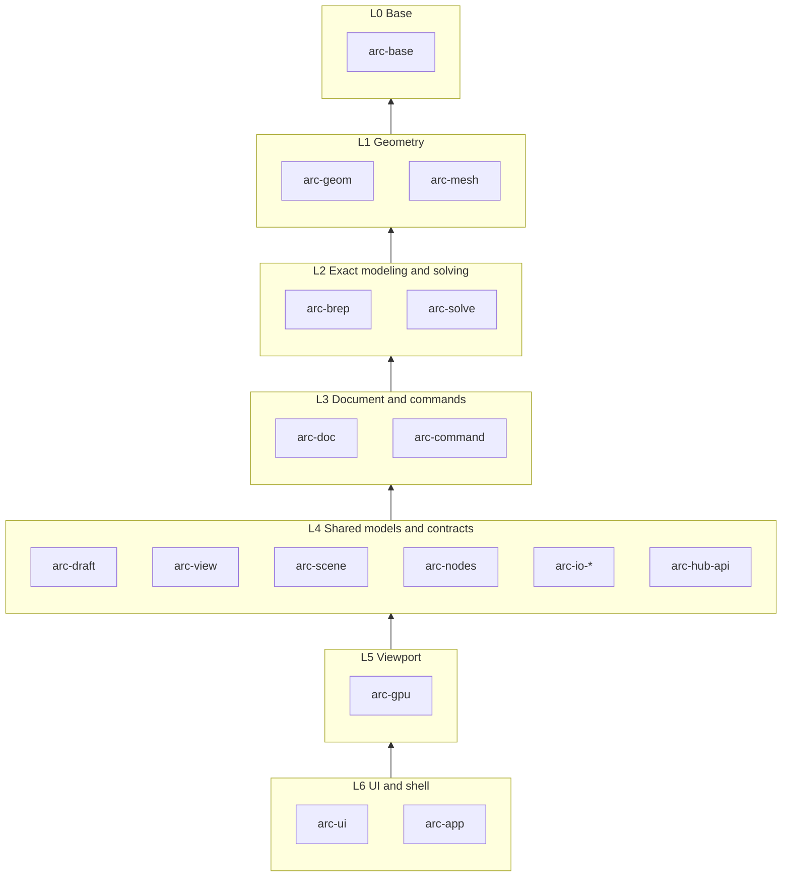

# Arc Core

The shared Rust foundation of the Arc suite: geometry, the document store and package, commands and
automation, drafting, rendering, the UI kit and interchange, written once and used by every Arc
product.

> **Status: foundation phase.** The workspace, the CI gate, `arc-base` and the first parts of `arc-geom`, `arc-mesh`, `arc-solve`, `arc-doc`, `arc-command` and `arc-app` exist; the other crates are specifications. No release is available yet; the documents in this repository describe the target that implementation follows.

## Building

The toolchain is pinned in `rust-toolchain.toml`. The gate also needs `cargo-nextest`,
`cargo-deny` and `cargo-audit` (`cargo install --locked cargo-nextest cargo-deny cargo-audit`).

```sh
cargo xtask ci      # every gate: format, clippy, layers, wasm, tests, features, deny, audit, catalogs, schemas
cargo xtask layers  # the layering check alone
```

## What arc-core is

Arc is a suite of native desktop applications and one collaboration server for designing buildings,
infrastructure, products and 3D content. Each product repository contains only its domain. Everything
that two or more products need, and every contract through which products cooperate at run time,
lives here as a set of Rust crates arranged in strict layers.

`arc-core` is not an application. It ships a reference shell (`apps/arc-shell`) and its headless
companion (`apps/arc-shell-cli`) that exercise the crates end to end and serve as the integration
test bed, but no product functionality.

## Layers



An arrow means "may depend on". A crate depends only on crates in lower layers; arrows are
transitive, so `arc-ui` may use `arc-base` directly.

## Crates

| Crate | Layer | Responsibility | Specification |
|---|---|---|---|
| `arc-base` | L0 | Identifiers, units and quantities, tolerances, error model, color, math aliases | [arc-base](docs/crates/arc-base.md) |
| `arc-geom` | L1 | Curves, surfaces, NURBS, intersections, 2D regions, triangulation, TIN, spatial indexes | [arc-geom](docs/crates/arc-geom.md) |
| `arc-mesh` | L1 | Polygon meshes, attributes, subdivision surfaces, mesh booleans, simplification | [arc-mesh](docs/crates/arc-mesh.md) |
| `arc-brep` | L2 | Boundary-representation solids, modeling operations, persistent topological naming, STEP-grade data | [arc-brep](docs/crates/arc-brep.md) |
| `arc-solve` | L2 | Geometric constraint solving, unit-aware expressions and parameters | [arc-solve](docs/crates/arc-solve.md) |
| `arc-doc` | L3 | Typed object store, transactions, operation journal, dependency graph, document package | [arc-doc](docs/crates/arc-doc.md) |
| `arc-command` | L3 | Commands, registry, prompt machines, command line, macros, automation protocol, headless runner | [arc-command](docs/crates/arc-command.md) |
| `arc-draft` | L4 | 2D drafting model: entities, styles, blocks, layouts, annotation scaling, plotting | [arc-draft](docs/crates/arc-draft.md) |
| `arc-view` | L4 | Derived views of 3D models: projection, hidden lines, sections, cut patterns | [arc-view](docs/crates/arc-view.md) |
| `arc-scene` | L4 | Renderable scene description and the Arc Scene contract | [arc-scene](docs/crates/arc-scene.md) |
| `arc-nodes` | L4 | Typed dataflow node-graph engine | [arc-nodes](docs/crates/arc-nodes.md) |
| `arc-io-*` | L4 | One crate per interchange format family, each producing a neutral model | [arc-io](docs/crates/arc-io.md) |
| `arc-hub-api` | L4 | Hub API types and client | [arc-hub-api](docs/crates/arc-hub-api.md) |
| `arc-gpu` | L5 | Real-time viewport renderer on wgpu | [arc-gpu](docs/crates/arc-gpu.md) |
| `arc-ui` | L6 | Widget kit on egui | [arc-ui](docs/crates/arc-ui.md) |
| `arc-app` | L6 | Application shell | [arc-app](docs/crates/arc-app.md) |

A crate is created when its first user needs it; the table is the target. Each specification lists
the crate's capabilities with permanent identifiers (`CORE-<AREA>-NNN`).

## Rules products rely on

- **Layering is enforced.** `cargo xtask layers` checks every dependency edge against the layer
  table and fails the build on an upward edge or on a UI, windowing or GPU dependency below L5.
- **L0–L4 are headless.** They build and run without a window, a GPU or a display server, so the
  same code serves desktop applications, headless CLIs, Hub workers and tests. A listed subset also
  builds for WebAssembly (the browser build); the same crates also build for iOS and Android.
- **One baseline tag.** `arc-core` is released as a whole under one version tag. Every product pins
  exactly one tag, and a suite release names the single tag all its products ship on.
- **Format crates produce neutral models.** An `arc-io-*` crate reads and writes a faithful model of
  its format and nothing else. The product owns the mapping between that model and its domain.
- **Changes go through commands.** No crate offers a path that mutates a document outside a
  validated command running in a transaction.
- **Production code does not panic** and `unsafe` code exists only in the FFI crates named in
  [the architecture overview](docs/architecture/overview.md#unsafe-code-and-ffi-crates).

## How products consume arc-core

Products declare `arc-core` crates as git dependencies pinned to one release tag. For local
development, all repositories are checked out side by side and a Cargo `[patch]` section in the
product workspace points at the local `arc-core` checkout. Publishing to crates.io is deferred
until an API is declared stable.

A product never depends on another product. Products cooperate at run time through three
contracts defined here: the Arc document package (`arc-doc`), the Arc Scene contract
(`arc-scene`) and the Hub API (`arc-hub-api`). Connectors running inside other
applications exchange models with products through a fourth, the Arc exchange package
(`arc-io-exchange`).

## Documentation

| Document | Content |
|---|---|
| [Documentation map](docs/README.md) | Every document in this repository |
| [Architecture overview](docs/architecture/overview.md) | Layers, dependency rules, threading, errors, versioning |
| [Document model](docs/architecture/document-model.md) | Objects, identifiers, transactions, journal, dependency graph |
| [Document package](docs/architecture/document-package.md) | The single-file SQLite package format |
| [Commands and automation](docs/architecture/commands-and-automation.md) | Commands, automation protocol, MCP, headless CLI |
| [Geometry](docs/architecture/geometry.md) | Geometry tiers, B-rep API and naming, constraint solver, expressions |
| [Drafting and views](docs/architecture/drafting-and-views.md) | 2D drafting model, plotting, derived views |
| [Rendering](docs/architecture/rendering.md) | Viewport renderer and the Arc Scene contract |
| [UI kit](docs/architecture/ui-kit.md) | Widgets, shell, localization, accessibility, interaction standards |
| [Interchange](docs/architecture/interchange.md) | Format crates, limits, loss reports, corpora |
| [Extensibility](docs/architecture/extensibility.md) | Node graphs and WebAssembly plug-ins |
| [Technology baseline](docs/architecture/technology-baseline.md) | Third-party choices and replacement conditions |
| [Crate specifications](docs/crates/README.md) | Purpose, scope and capabilities of each crate |
| [Testing](docs/testing.md) | Test kinds, CI gate, pull request requirements |
| [Roadmap](docs/roadmap.md) | Foundation milestones and exit criteria |
| [Decisions](docs/adr/README.md) | Architecture decision records for this repository |
| [Glossary](docs/glossary.md) | Vocabulary |

Suite-wide decisions are recorded in [arc-suite](https://github.com/ACKaraca/arc-suite/tree/main/docs/adr).

## Contributing

Read [CONTRIBUTING.md](CONTRIBUTING.md). Work starts from an issue. Changes that alter a public
interface, the document package or a protocol need an architecture decision record. Automated
agents follow [AGENTS.md](AGENTS.md).

## License

Licensed under the [Apache License, Version 2.0](LICENSE). See [NOTICE](NOTICE).

## Trademarks

Arc, ArchBuilder, DraftBuilder, CivilBuilder, SolidBuilder, MeshBuilder, RenderBuilder, Arc Review and Arc Hub are names of this project and are not covered by the Apache License; see the [trademark policy](https://github.com/ACKaraca/arc-suite/blob/main/TRADEMARKS.md). All other product and company names are trademarks of their respective owners and are used only to describe scope and interoperability.
