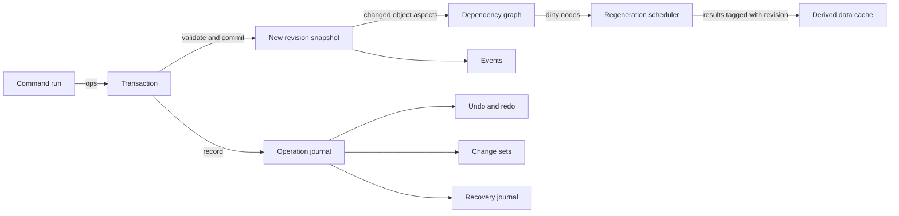

# Document model

The in-memory model that `arc-doc` provides to every product: how objects are stored and addressed,
how they change, how history is kept, and how derived data is recomputed. Storage on disk is
described in [document-package.md](document-package.md).

## Concepts at a glance

A **document** is a set of typed objects, a schema registry, the operation journal, the dependency
graph with its derived data cache, document settings and external references. One process may hold
several documents; they share the worker pool and nothing else.

## Objects and typed stores

An **object** is the unit of identity, change, reference and history. Every object has:

| Part | Content |
|---|---|
| Identifier | A persistent 128-bit `ObjectId` |
| Type key | A namespaced string naming its registered type, for example `core.draft.line` or `archbuilder.wall` |
| Header | Owner (`ObjectId` of the containing object, optional), name (optional), partition key, flags (`hidden_from_ui`, `system`, `read_only`) |
| Fields | The typed data defined by the type's schema |
| Property sets | Zero or more dynamic, user-defined property sets (see below) |

Each object type is registered in a **type registry** with its type key, current schema version,
field descriptors, validators, migrations and the relationship rules of its reference fields. The
registry is an explicit value, not global state: the application builds one at start, registers
each type once, and hands it, shared and immutable, to every document it opens; tests and tools
may hold several registries in one process. Type keys are prefixed by their owner: `core.` for
types defined in `arc-core`, the repository name for product types
(`solidbuilder.feature.extrude`). A type key never changes meaning; a type that is redesigned gets
a new major schema version, not a new key.

Objects of one type key live in a **typed store**. Objects are dynamically typed: an object is
its header and one optional field value per field of its registered schema, and a store is the
store of one type key, so types registered at run time need no compiled code. A store holds
immutable object values in chunks of 1,024 slots; a slot holds a reference-counted pointer to an
object value. The chunks are the leaves of a persistent radix trie, so writing an object replaces
the pointer in a copy of its chunk and copies only the trie nodes above it; unchanged chunks are
shared between revisions. The store is not an entity-component system: an object's fields belong to its type, and cross-cutting
data is attached through property sets or relationship objects, never by adding components at run
time.

## Persistent identifiers and in-memory handles

| | `ObjectId` | `Handle` |
|---|---|---|
| Size | 128 bits | 32-bit slot index and 32-bit generation, plus the index of its typed store |
| Form | UUID version 7 | Generational index into one typed store |
| Scope | Global and permanent | One document, one process, one session |
| Persisted | Yes: package, journal, change sets, protocol, references | Never |
| Lookup | Sharded persistent hash index (64 shards) to a handle | Direct slot access with generation check |

Rules:

- An `ObjectId` is assigned when an object is created and never changes. It is never reused, even
  after deletion.
- Copying an object (copy and paste, array, mirror, duplicate document) assigns new identifiers
  and records the source identifier in the journal operation so lineage is traceable.
- Importing from a format that has its own identifiers (IFC GlobalId, DWG handle, STEP entity
  name) assigns new `ObjectId`s and records each source identifier in the document's **source map**
  (object, source format, source document, source identifier). Re-importing the same source maps
  back to the same objects through the source map.
- Tests and deterministic batch runs can seed the identifier generator; a seeded generator produces
  the same sequence for the same inputs.
- Handles are resolved freshly from a snapshot. A handle obtained from one revision stays valid for
  reading that revision; a stale handle (deleted, rolled back or never published object) resolves
  to `doc.object.not_found`, never to another object. Generations are drawn from a per-store
  counter shared by every branch of the document's history that never goes back, so no slot and
  generation is handed out twice.
- A **sub-object key** addresses parts that are not objects (a vertex of a polyline, a face role of
  a wall, a row of a table): `(ObjectId, u32 local key)`. Local keys are assigned by the owning type
  and remain stable across edits that do not delete the part.

The decision and its alternatives are recorded in
[ADR-0002](../adr/0002-persistent-identifiers-and-handles.md).

## Fields, properties and schemas

**Fields** are declared by the object type. Field value types:

| Value type | Notes |
|---|---|
| `bool`, `i64`, `f64`, `string` | Strings are UTF-8, length-bounded by the schema |
| `quantity` | `f64` in SI base units with a declared physical dimension (length, angle, area, volume, mass, time, temperature, force, pressure and others from `arc-base`) |
| `enum` | A closed set of named values with stable numeric codes |
| `point2`, `point3`, `vector3`, `transform` | `f64` model coordinates; a transform is affine and invertible |
| `color` | Linear RGBA plus an optional indexed or named source |
| `reference` | `ObjectId` of a target type, with a relationship rule |
| `external_reference` | `(link id, ObjectId)` into a linked document |
| `asset` | Content hash of an asset in the document's asset store |
| `geometry` | A geometry value from `arc-geom`, `arc-mesh` or `arc-brep`, encoded by its owning crate |
| `list<T>`, `map<string, T>`, `record` | Bounded collections and nested records |
| `opaque` | Bytes preserved for a foreign or newer schema, never interpreted |

Each field declares a name, value type, default, valid range or length bound, whether it is
optional, whether it is **indexed** (copied to the package property index for queries; only
scalar fields of the object itself, not opaque, record, list, map or geometry fields or fields of
nested records) and which **aspect** it belongs to. An aspect is a named group of fields
(`geometry`, `appearance`, `identity`, `data`) used as the unit of dependency tracking. The
package stores each declaration as a field descriptor, whose contents are listed in
[document-package.md](document-package.md#payload-encoding).

**Property sets** carry user-defined and standard data (IFC property sets, classification codes,
cost data). A property set definition is itself an object: name, applicable types, and an ordered
list of property definitions (name, value type, unit dimension, enum values, default, required). An
object stores property set instances by definition `ObjectId`. Property values use the same value
types as fields except `geometry` and `opaque`. Changing a definition (adding a property, renaming,
changing a default) is a transaction like any other and migrates existing instances inside it.

## Relationships and references

A reference field stores the target's `ObjectId`. Every reference field declares a **relationship
rule** in its descriptor:

| Rule part | Values | Effect |
|---|---|---|
| Strength | `owning`, `associative`, `informational` | Owning: the target's life ends with the source (cascade delete). Associative: the source depends on the target. Informational: navigation only |
| On target delete | `cascade`, `clear`, `block` | Delete the source, clear the reference (an optional field becomes empty, a list loses the element; cardinality `optional` or `many`), or refuse the deleting transaction |
| On copy | `copy_target`, `share_target`, `clear` | Whether a copy of the source copies, shares or drops the target; an owned target is never shared |
| Cardinality | `one`, `optional`, `many` (bounded list) | |

Commit validation guarantees that no reference dangles: every committed reference resolves to a
live object of an allowed type, or the transaction is rejected with `doc.reference.dangling`.

Relationships with attributes or more than two participants (a connection between members, a
space boundary, an assignment to a system) are modeled as **relationship objects**: ordinary
objects whose fields reference the participants. The document maintains a **reverse reference
index** (target → sources with field and rule) so that deletes, change propagation and "used by"
queries do not scan stores.

### References across documents

A document links another document through an **external reference object** of type
`core.doc.link`: target document `ObjectId`, path relative to the referencing document (absolute
only when no relative path exists), optional Hub resource identifier, the revision last loaded, and
a load mode (`full`, `partition list`, `not loaded`). Linked documents open read-only in the same
process. Their objects are addressed by `external_reference` values `(link id, ObjectId)`.

- A missing or unloadable link keeps the link object and every external reference intact, marks
  them `unresolved`, and reports the link in diagnostics; nothing is deleted or rewritten.
- When a linked document changes on disk, the link reports `outdated`; reloading is an explicit,
  undoable command that records the old and new linked revisions.
- Cycles of links are allowed (A links B, B links A); each document is loaded once per process.
- Edits never write through a link. Products that need to edit linked content open the target
  document.

## Transactions

A **transaction** is the only way objects change. Commands open transactions through the
document executor (see [commands](commands-and-automation.md)); no other public path mutates a
store.

Life cycle: `open → (operations, savepoints) → validate → commit | roll back`.

- **Operations** inside an open transaction: create, modify fields, modify property sets, delete,
  and relink (change owner). Reads inside the transaction see its own uncommitted changes.
- **Savepoints** allow a command to roll back part of its work (for example a failed sub-step)
  without abandoning the transaction.
- **Validation** at commit runs in this order: field schema checks on touched objects; reference
  integrity and relationship rules (including cascades, which add operations); type validators of
  touched objects; document-level validators registered by the product. Any error rolls the whole
  transaction back. Warnings are attached as diagnostics and do not block.
- **Commit** assigns the next revision number, publishes the new snapshot atomically, appends the
  transaction record to the journal, enqueues the record for the recovery journal, marks the
  dependency graph dirty and emits events.
- A transaction is bounded: at most 10 million operations and the configured memory budget; a
  larger change must be split by the command into groups (see grouping).
- Exactly one transaction is open per document at a time, on the document executor. Read-only
  queries never open transactions.

**Revisions.** Each commit increments a 64-bit revision counter local to the open session. The
persistent identity of a state is the `TransactionId` of its last transaction; revision numbers
are for ordering within a session and for tagging derived data.

## Operation journal

The journal is the append-only list of committed transaction records. It drives undo and redo,
history, change comparison, crash recovery and change sets for multi-user editing. Derived data is
never journaled: undoing restores inputs and the dependency graph recomputes the rest.

### Record shape

| Field | Content |
|---|---|
| `txn_id` | UUID version 7 of the transaction |
| `parent` | `txn_id` of the transaction this one was applied on |
| `session` | Session identifier (process run) |
| `author` | User identity string from settings or Hub sign-in |
| `time` | UTC timestamp |
| `command` | Command identifier and its parameters in canonical JSON |
| `label` | Message identifier and arguments for the history list |
| `group` | Group identifier, if part of a group |
| `kind` | `normal`, `undo_of(txn_id)`, `redo_of(txn_id)`, `merge`, `migration`, `link_reload` |
| `selection_after` | Optional selection to restore |
| `ops` | Ordered operations |

Operations:

| Operation | Content |
|---|---|
| `create` | id, type key, schema version, full encoded value, optional `copied_from` id |
| `modify` | id, schema version, list of changed field paths with encoded before and after values |
| `modify_properties` | id, definition id, list of changed property names with before and after values |
| `delete` | id, type key, schema version, full encoded value before deletion |
| `relink` | id, owner before, owner after |

Field-level before and after values make every record self-inverting and give change sets precise
conflict detection. Large values (meshes, point sets, images) are stored as assets and appear in
operations only as content hashes, so records stay small. The format is specified in
[ADR-0003](../adr/0003-journal-records-and-structural-sharing.md).

### Undo and redo

- The journal is append-only. Undo applies the inverse of the target transaction (or group) as a
  new transaction with kind `undo_of`; redo applies the original operations again as `redo_of`.
  The undo and redo stacks hold transaction identifiers.
- One undo step corresponds to one completed command. An interactive command that commits several
  transactions (for example a polyline with many segments) groups them so they undo as one step;
  its prompt machine may offer an in-command step back, which rolls back within the open group.
- **Coalescing.** Consecutive transactions with the same coalesce key (a drag of the same grip, a
  slider scrub on the same field) committed within one gesture merge into one undo step.
- A new normal transaction after undo clears the redo stack.
- Undo is refused with `doc.undo.conflict` if a later transaction (from a linked reload, a merge or
  another user's change set) modified the same field after the transaction being undone; the user
  is offered a comparison instead.
- Limits: a step count (default 1,000) and a memory budget for retained inverse data (default
  1 GiB). When exceeded, the oldest steps leave the undo stack but stay in the journal.
- Undo history survives save and stays available for the session. Package history retention is a
  document setting: `none`, `since last N saves`, or `full`.

### Grouping

A **group** wraps several transactions under one label and one undo step: a script run, a macro
playback, an automation batch, a command that commits in stages. Groups nest; only the outermost
group forms the undo step. An open group is closed by its owner or, if the owner fails, rolled back
as a whole.

### History and change comparison

- **History** lists transaction records with author, time and label, filterable by object, type,
  author and time range. Selecting an object shows the transactions that touched it.
- **Comparison** of two states produces a per-object result: created, deleted, modified (with the
  changed field and property paths and both values), relinked. When both states lie on one journal
  path, comparison folds the records between them. Otherwise it compares snapshots: chunks shared
  by pointer are skipped, and remaining objects are compared by encoded value hash. Comparison
  works between revisions of one session, between a document and its saved file, between two
  package files, and between a document and a change set.
- Comparison output has a canonical JSON form, stable for the same inputs, suitable for text diffs
  in review tools and CI.

### Change sets

A **change set** is the unit exchanged for multi-user editing: a base state (`txn_id`), an author,
and an ordered list of journal records made on that base. Applying a change set to a document whose
current state is the base replays the records. Applying it to a later state **rebases** it:

- Two operations commute when they touch disjoint `(object, field path)` or `(object, property)`
  pairs, or when one is a create of a new object. Commuting operations replay unchanged.
- An operation conflicts when the target field was changed after the base by another record, or
  the target object was deleted. Conflicts are never resolved by discarding: the incoming version
  is kept in a **conflict record** (object, field paths, base value, current value, incoming value,
  authors) and the current value stays in place until a user resolves the conflict with a command.
- Validation runs on the rebased result; a change set whose rebased result fails validation is
  held as pending with its diagnostics instead of being applied partially.
- Element borrowing (locks held through Arc Hub) is checked before a change set leaves the client.

Change sets are a phase 5 capability; the record format is defined from phase 0 so journals
written earlier remain usable.

## Structural sharing and snapshots

A **snapshot** is an immutable view of the whole document at one revision: one pointer per typed
store root, the identifier index root, the reverse reference index root, settings and the link
table, held together behind one reference-counted pointer. Taking a snapshot copies that pointer
and costs constant time. A transaction copies only the chunks, index nodes and objects it touches
and the trie nodes on the paths to them; every other part is shared with the previous revision.
A transaction's changes are published only if the published snapshot is still the one they were
made on.
The storage layer is specified in [arc-doc](../crates/arc-doc.md#stores-identifier-index-and-snapshots-core-doc-002-core-doc-003-core-doc-017).

Uses: the UI and viewport read the latest snapshot without locks; save serializes a snapshot while
editing continues; regeneration jobs read the snapshot of the revision they compute for; automation
queries are answered against a stated revision; comparison skips shared chunks by pointer equality.
Memory is reclaimed when no reader holds an old snapshot.

## Dependency graph

Derived data (element geometry, joins, tessellations, drafting display lists, views, schedules,
toolpaths, corridor sections, node-graph outputs) is computed by the dependency graph owned by
`arc-doc`.

- A **node** is identified by `(ObjectId or graph-local id, derived key)`, for example
  `(wall, "core.geometry.solid")` or `(view, "core.view.display_list")`. Products register derived
  keys with an evaluator function and a result type.
- **Inputs** are `(ObjectId, aspect)` pairs and other nodes. Evaluators read inputs only through
  the evaluation context, which records each read. Dependencies are therefore captured
  automatically on every evaluation and may change between evaluations; evaluators never declare
  them by hand.
- Evaluators are pure functions of their recorded inputs and must not mutate the document. An
  evaluator that needs to change objects (for example to update a cached field that users see)
  returns a request that the scheduler turns into a follow-up command transaction, tagged
  `regeneration`.
- Results are memoized with the inputs they read and a hash of the result.

### Dirty propagation

On commit, the set of changed `(object, aspect)` pairs marks the nodes that read them dirty, and
dirtiness propagates to their dependents. **Early cutoff:** when a recomputed node's result hash
equals its previous hash, its dependents are cleaned without recomputation. Deleting an object
removes its nodes and marks their dependents dirty.

### Regeneration scheduler

| Priority | Assigned to |
|---|---|
| `blocking` | Nodes a running command requested synchronously (`ensure`) |
| `interactive` | Nodes visible in the active viewport or sheet |
| `visible` | Nodes visible in other open views |
| `background` | Everything else that is dirty, so saves and exports find clean data |

- Work runs on the shared worker pool, highest priority first; independent nodes run in parallel.
- **Cancellation.** Each job holds a cancellation token checked at evaluator yield points. When a
  commit makes a running job's inputs dirty, its token is cancelled and the node is rescheduled.
  Evaluators must reach a yield point at least every 50 ms of computation.
- **Revision tagging.** Every result carries the revision of the snapshot it was computed from and
  the version of each node result it read. A result is applied only if none of its recorded
  inputs changed after that revision; otherwise it is discarded. A stale result is never applied.
- A command may call `ensure(nodes)` to block until the listed nodes are clean for the current
  revision inside its transaction. `ensure` evaluates against the transaction's uncommitted state
  and its results are discarded if the transaction rolls back.

### Failure states

| State | Meaning | Shown to users as |
|---|---|---|
| `clean` | Result valid for current inputs | Normal |
| `dirty`, `scheduled`, `running` | Recomputation pending | Last result with a pending indicator, if one exists |
| `failed` | Evaluator returned an error | Error diagnostic on the object; last good result, if any, drawn marked as out of date |
| `blocked` | An input node is `failed` or `cyclic` | Diagnostic naming the upstream object |
| `cyclic` | The node takes part in a dependency cycle found during evaluation | Diagnostic listing the cycle |

Failures never roll back the transaction that caused them and never remove objects. They are
listed in the document diagnostics and cleared automatically when a later evaluation succeeds.

## Events

Events are emitted after commit on the document executor and delivered to subscribers through
bounded channels. Subscribers may read snapshots; they may not mutate the document from an event
handler (they issue commands instead).

| Event | Payload |
|---|---|
| `committed` | Revision, `txn_id`, kind, changed object ids grouped by type and change kind |
| `regenerated` | Revision, node keys that became clean or failed |
| `diagnostics_changed` | Added and removed diagnostics |
| `saved` | Path, format version, revision saved |
| `link_state_changed` | Link id, new state |
| `conflict_recorded` | Conflict record ids |

A slow subscriber receives coalesced events (the latest revision and the union of changes) rather
than blocking the executor. Selection is session state held by the application, not by the
document; its changes are application events.

## Validation

| Level | When | Effect of failure |
|---|---|---|
| Field schema | Every touched field at commit | Reject transaction |
| Reference integrity and relationship rules | At commit | Reject or cascade per rule |
| Type validators | Touched objects at commit | Error rejects; warning becomes a diagnostic |
| Document validators | At commit, registered by the product | Error rejects; warning becomes a diagnostic |
| Load validation | When a package or change set is read | Invalid objects are quarantined (kept, read-only, listed) instead of failing the load |
| Model checking | On demand, product rules | Report only |

Validators run inside the commit and must be fast; work that needs derived geometry belongs in a
dependency-graph node that produces diagnostics, not in a validator.

## Schema migration

- Each type has a schema version `major.minor`. A **minor** increment may only append fields at
  the end of the field list, each of them optional or with a default. A **major** increment may
  change anything and requires a migration function from the previous major.
- Migrations are pure functions on decoded values: `vN → vN+1`, chained. They run when objects are
  loaded, in memory; the file changes only when the user saves.
- Loading a document that contains a type of a newer **minor** version decodes the known fields and
  preserves the unknown trailing bytes; the application opens such a document read-only, with a
  message naming the type and the version that wrote it.
- Loading a newer **major** version of any type refuses to open the document unless the user
  chooses a read-only view that shows only objects of known versions; the file is never modified.
- A type whose key is not registered at all (a product type opened by another product, a removed
  type) is loaded as a **preserved object**: header and encoded bytes kept, references kept for
  integrity, shown in diagnostics, written back unchanged. Until schemas can be built from stored
  descriptors, the references a preserved object keeps for integrity are its header owner; its
  field references stay in its encoded bytes.
- Every migration ships with a test that loads a stored fixture of the old version and compares the
  result with the expected new value.
