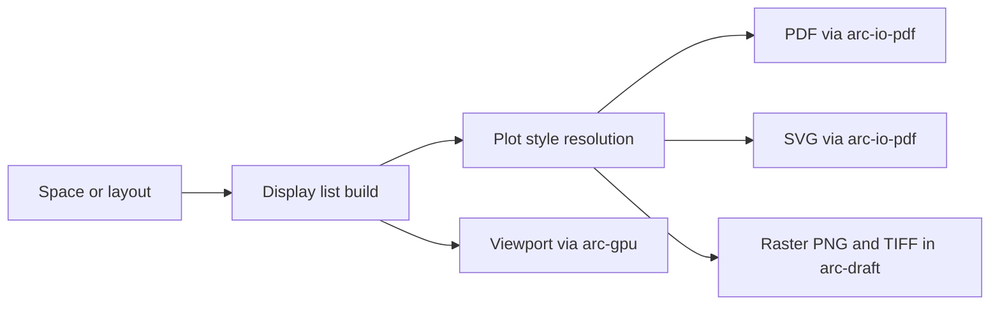

# Drafting and views

The 2D drafting model every product uses for drawings and sheets (`arc-draft`) and the derivation
of drawings from 3D models (`arc-view`). One drafting engine means that details, annotations, sheets
and plots behave the same in every product.

## The drafting model (arc-draft)

`arc-draft` defines drafting object types (`core.draft.*`) registered in the `arc-doc` type
registry, the rules that resolve their appearance, and the pipeline that turns a space into display
primitives and plot output. Products store these objects in their own documents. DraftBuilder maps
its DWG and DXF drawing database onto these types in its own repository; other products use them for
annotation, details and sheets.

### Spaces and units

| Concept | Definition |
|---|---|
| Space | A 2D coordinate system that owns drafting objects: a **model space** (or a 2D drafting view of a 3D model) or a **sheet space** (a layout) |
| Space unit | Every space declares its unit. Model spaces use the drawing's declared unit (unitless, millimetre, centimetre, metre, inch, foot, or another declared length unit) for DWG fidelity; sheet spaces use millimetres |
| Conversion | Happens only at explicit boundaries: a sheet viewport's scale, a block inserted from a drawing with another unit, an import. Conversions use typed quantities, never bare factors |
| Elevation and thickness | Drafting objects are 2D with optional elevation and extrusion direction, preserved for DWG fidelity |

### Entities

| Group | Types |
|---|---|
| Curves | Point, line, ray, construction line, circle, arc, ellipse and elliptical arc, polyline (with bulges and per-vertex widths), spline |
| Fills | Hatch (pattern, solid, gradient) with boundary associativity, solid fill, wipeout (masking region) |
| Text | Single-line text, multi-line rich text (paragraphs, runs with font, height, color, stacking of fractions, tab stops, columns), fields (expressions evaluated from document data) |
| Dimensions | Linear (horizontal, vertical, aligned, rotated), angular, radial, diameter, arc length, ordinate, baseline and continued chains; associative to geometry through sub-object keys |
| Leaders | Leaders and multi-leaders with text, block or tolerance content |
| Tables | Cell grids with merged cells, typed cell content (text, number with format, formula, block), styles per row type |
| Blocks | Block definitions, block references with attributes, nested references, arrays of references |
| References | External drawing references, image underlays, PDF underlays, point-cloud references (placement only; content via `arc-io-*`) |
| Viewports | Sheet viewports showing a model space or a derived view at a scale |
| Preserved | Preserved drafting entities from imports (kept bytes plus a proxy display list) |

### Styles and appearance

Appearance properties (color, layer, linetype, linetype scale, lineweight, transparency, plot
style) resolve in a fixed order: explicit object value → block reference value (for values set to
"from block") → layer value (for values set to "from layer") → viewport layer override (for sheet
viewports). Style tables are document objects:

| Style | Defines |
|---|---|
| Layer | Name, color, linetype, lineweight, transparency, plot style, on/off, frozen, locked, plottable, description; per-viewport overrides |
| Linetype | Dash, gap and dot pattern in space units, optional embedded text or shapes, scale behavior |
| Text style | Font (outline or Arc single-stroke), height (fixed or variable), width factor, oblique angle, direction |
| Dimension style | Arrowheads, extension and dimension line geometry, text placement and format, units and precision, tolerances, scale; with child styles per dimension kind |
| Leader style | Arrowhead, landing, content type and layout |
| Table style | Cell margins, text styles, borders and formats per row type |
| Hatch pattern | Line families (angle, origin, offset, dash pattern) in pattern units, plus solid and gradient definitions |

Arc ships its own linetype and hatch-pattern libraries and its own single-stroke drafting fonts;
products may load further libraries from documented files.

### Annotation scaling

An **annotative** object (text, dimension, leader, hatch, block reference, table) stores sizes in
sheet units and one **scale representation** per annotation scale it supports. Each
representation may override position. A model-space view or sheet viewport at scale *s* displays
the representation for *s*; objects without a representation for the current scale are hidden in
that viewport or, by setting, shown at the nearest scale with a marker. Adding a scale to the scale
list never changes existing representations. Non-annotative objects scale with the model.

### Blocks and external references

- A block definition owns its entities, a base point, a unit, and attribute definitions (tag,
  prompt, default, constant, invisible, preset, multi-line).
- A block reference holds the definition, insertion point, scale per axis, rotation, attribute
  values and, for arrays, the array parameters. Editing a definition updates every reference
  through the dependency graph.
- Nesting depth is bounded (default 64); cyclic definitions are rejected on commit.
- External drawing references are `core.doc.link` objects with a placement; their content is
  displayed, snapped to and listed but never edited in place; bound references become blocks.
- Dynamic behavior of blocks (parameters and actions) is a product concern; `arc-draft` stores
  parameter values and preserves imported dynamic data.

### Layouts and sheets

A **layout** is a sheet space with paper size, orientation, printable area, origin, plot scale
(normally 1:1), and plot settings. It contains a title block (usually a block reference with
attributes bound to fields), viewports, annotations and revision data. Viewports have a scale, a
center, a rotation, a clip boundary (rectangular or arbitrary closed curve), per-viewport layer
visibility and overrides, an annotation scale and a lock flag. Products build their sheet sets on
top of layouts.

### Plot pipeline

- **Display list.** `arc-draft` converts a space into a display list of primitives: polylines with
  linetype and width, filled polygons, gradient fills, glyph runs, images and clip groups. Each
  primitive carries the `ObjectId` and sub-object key it came from. Curves stay exact in the
  display list (arcs, ellipses, splines); flattening happens in the consumer at the consumer's
  tolerance. Display lists are derived data in the dependency graph, rebuilt per changed object.
- **Plot style resolution** maps object appearance to pen output: color (as is, grayscale,
  monochrome or a mapped pen color), lineweight in millimetres, screening, line end and join style,
  fill style. Two plot style table kinds are supported: color-mapped tables and named-style tables;
  both are documented file formats owned by Arc and import mappers are product concerns.
- **Output.** PDF (vector, with text as text where fonts allow, layers as optional content groups,
  hyperlinks, PDF/A option), SVG, and raster (PNG, TIFF) at a stated DPI. Multi-sheet PDF output
  writes one page per layout. Batch plotting runs headless through the CLI.
- Plot output is deterministic: the same document and settings produce byte-identical PDF and SVG
  (except an optional creation date, which tests disable).

## Derived views (arc-view)

`arc-view` produces drawings of 3D models: plans, sections, elevations, details and axonometric or
perspective drawings. Results are `arc-draft` geometry in a view space, linked back to the 3D
objects they came from.

### Inputs

A product supplies a **view source**: for each object in scope, its solid, mesh or curve geometry
(from the dependency graph), its category, and the cut and projection styles the product assigns
(line style per visibility class, cut fill pattern and lineweight, material). Solids implement the
section input through `arc-brep`; meshes and polyhedral solids through `arc-mesh`. `arc-view` never
decides domain styling; it applies what the source provides.

### View definition

| Parameter | Meaning |
|---|---|
| View frame | Eye, direction, up, projection (orthographic or perspective), from `arc-geom` |
| Cut plane | Optional plane where the model is cut (plans, sections) |
| Range | Near and far depth limits; objects beyond the far limit are omitted, objects between cut and far are "beyond" |
| Overhead range | Optional range above the cut whose objects draw with the overhead style |
| Crop | Optional 2D boundary in the view plane |
| Scope | Object filter supplied by the product |
| Detail level | Coarse, medium or fine; passed to the source so it can supply simplified geometry |

### Projection and hidden-line removal

- Every object contributes **edges**: sharp feature edges (above a crease angle), boundary edges,
  silhouette edges computed for the view direction, and cut edges.
- **Polyhedral hidden-line removal** (default) works on tessellations at a tolerance derived from
  the view scale so errors stay below 0.05 mm on the sheet. It classifies every edge segment as
  visible or hidden by occlusion against all faces in range, runs in parallel by screen-space tiles,
  and merges collinear segments.
- **Exact hidden-line removal** for B-rep solids uses the kernel tier through `arc-brep` when the
  view requests exact output (mechanical drawings). Results are exact curves.
- Output segments are classified: `visible`, `hidden`, `cut`, `beyond`, `overhead`, `silhouette`.
  Each class maps to a line style from the source.
- Incremental update: a change to one object recomputes only that object's edges and the occlusion
  of edges in its screen-space footprint.

### Section cuts and fill patterns

- Cutting a solid produces closed **cut regions** (exact for B-rep, planar mesh sections for meshes)
  per object. Regions of objects that the source marks as joinable (same material and category)
  merge, so walls of one material show one continuous fill.
- Each region receives the fill pattern, pattern scale and orientation, and boundary lineweight from
  the source; patterns are `arc-draft` hatches aligned to a stable origin so they do not shift when
  the view regenerates.
- Non-closed or invalid section results are reported as diagnostics on the object and drawn as cut
  edges without fill.

### Links back to source objects

Every primitive of a derived view carries `(source ObjectId, sub-object key, visibility class)`.
For solids the sub-object key is the `TopoName` of the face or edge; for product objects it may be a
semantic role (face role, layer of a compound wall). This enables:

- **Selection:** picking a line in a view selects the source object, and highlights all of its
  primitives.
- **Annotation anchoring:** dimensions, tags and leaders in a view reference `(view, source id,
  sub-object key, parameter on edge)`. After regeneration they re-attach by key; if the key no
  longer exists, the annotation is marked **orphaned**, keeps its last position and appears in the
  diagnostics list for the user to re-attach or delete.
- **Overrides:** per-view graphic overrides by object or category, applied when the view is built.
