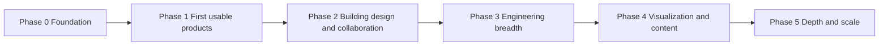

# Roadmap

Foundation milestones mapped onto the suite phases. Phases have exit criteria, not dates. Each
milestone lists the crates it delivers, the capabilities in scope (every capability of that crate
whose Phase column equals the milestone's phase, unless narrowed), and acceptance scenarios that
must pass in CI on all three desktop platforms.

## Phase 0: Foundation

Goal: L0–L3 and L5–L6 at minimum, with gates, release pipeline and a reference shell that opens,
edits, saves and undoes a document with a viewport.

| Milestone | Crates | Scope |
|---|---|---|
| F0.1 Workspace and gates | `xtask` | Layer table and `cargo xtask layers`, `cargo xtask wasm`, `cargo xtask ci`, workspace lints, `cargo deny` configuration, release tagging |
| F0.2 Base and 2D geometry core | `arc-base`, `arc-geom` | Phase 0 rows of CORE-BASE and CORE-GEOM |
| F0.3 Document store and journal | `arc-doc` | Phase 0 rows of CORE-DOC except package rows |
| F0.4 Package and recovery | `arc-doc` (`package`) | CORE-DOC-040 to CORE-DOC-047, CORE-DOC-050, CORE-DOC-051 |
| F0.5 Commands and automation | `arc-command`, `arc-solve` (expressions) | Phase 0 rows of CORE-CMD and CORE-SOLVE |
| F0.6 Viewport | `arc-mesh` (indexed meshes), `arc-gpu` | Phase 0 rows of CORE-MESH and CORE-GPU |
| F0.7 UI kit and shell | `arc-ui`, `arc-app` | Phase 0 rows of CORE-UI and CORE-APP |
| F0.8 Reference shell | `apps/arc-shell`, `apps/arc-shell-cli` | CORE-APP-025, CORE-APP-026 |

Exit criteria:

1. **Edit, save, undo.** In the reference shell, a user creates sample objects (points, lines and
   boxes with properties) in the viewport and through the command line, changes properties in the
   property grid with unit expressions (`1200 mm + 3 in`), saves, closes, reopens, and finds an
   identical document (empty comparison). Undo and redo step through every change, also after the
   save, and the outliner, property grid and viewport stay consistent.
2. **Crash recovery.** The shell process is killed during editing; on restart, the recovery prompt
   offers the session and recovery restores every transaction committed more than one second before
   the kill.
3. **Atomic save.** A test harness kills the process at random points during 1,000 saves; the file
   always opens and equals either the previous or the new state.
4. **Locking.** A second shell instance opening the same file opens it read-only and names the
   holder.
5. **Headless parity.** `arc-shell-cli run` applies the same commands as the interactive scenario
   from a macro and produces a package whose canonical dump equals the interactive result with the
   same seed. `arc-shell-cli serve --stdio` passes the protocol conformance suite, and
   `render` produces an image matching the reference within threshold.
6. **Gates.** `cargo xtask ci` is green; `cargo xtask layers` rejects a seeded upward dependency in
   its own test; the WebAssembly set builds; the panic-hunt test covers every shell command.
7. **Accessibility.** The edit, save, undo scenario completes with keyboard only; every control has
   an accessible name; the shell renders correctly at 200 % scale and in Turkish.
8. **Compatibility seed.** The first package fixtures are stored under `fixtures/packages/` and the
   refusal test for a newer major format passes.

## Phase 1: First usable products

Goal: what DraftBuilder's 2D core and the Arc Review viewer need.

| Milestone | Crates | Scope |
|---|---|---|
| F1.1 Drafting model and plotting | `arc-draft`, `arc-geom`, `arc-gpu` (lines, hatches, text) | Phase 1 rows of CORE-DRAFT, CORE-GEOM and CORE-GPU-008 to CORE-GPU-013 |
| F1.2 DXF and DWG reading | `arc-io-dxf`, `arc-io-dwg` | CORE-IO-001 to CORE-IO-011 |
| F1.3 PDF and SVG output | `arc-io-pdf` | CORE-IO-037, CORE-IO-038 |
| F1.4 Review formats | `arc-io-ifc`, `arc-io-mesh`, `arc-io-step`, `arc-brep` (import, tessellation) | CORE-IO-014, CORE-IO-015, CORE-IO-020, CORE-IO-023 to CORE-IO-025; phase 1 rows of CORE-BREP |
| F1.5 Large-model viewing | `arc-gpu`, `arc-mesh` | CORE-GPU-005, CORE-GPU-018 to CORE-GPU-021, CORE-GPU-024, CORE-GPU-026; phase 1 rows of CORE-MESH |
| F1.6 Automation surfaces | `arc-command`, `arc-app` | CORE-CMD-012 to CORE-CMD-018, CORE-CMD-020, CORE-CMD-023 to CORE-CMD-029, CORE-CMD-034; CORE-APP-016 to CORE-APP-018, CORE-APP-020 |
| F1.7 Document links and comparison | `arc-doc` | CORE-DOC-005, CORE-DOC-006, CORE-DOC-011, CORE-DOC-012, CORE-DOC-025, CORE-DOC-026, CORE-DOC-033, CORE-DOC-049, CORE-DOC-052 |

Exit criteria:

1. A DXF drawing with layers, linetypes, hatches, text, dimensions, blocks with attributes and two
   layouts opens, displays identically in model space and layouts, and plots to PDF and SVG whose
   reference comparison passes; writing DXF and reading it back gives an equal neutral model.
2. Every DWG file in the pinned corpus opens with a loss report and no crash; malformed files fail
   with errors.
3. An IFC4 model of 2 million triangles, a STEP assembly and a glTF scene open, orbit at the frame
   target, section with a box, and report measurements exact to the model coordinates.
4. A STEP file that crashes the kernel in a test build fails its import with `worker.crashed` while
   the application keeps running.
5. An MCP client lists tools, queries objects, renders a view and, when attached with edit allowed,
   applies a command only after approval in the application.
6. A macro recorded in the shell plays back identically through the CLI.

## Phase 2: Building design and collaboration

| Milestone | Crates | Scope |
|---|---|---|
| F2.1 Derived views | `arc-view` | All CORE-VIEW rows of phase 2 |
| F2.2 Exact solids for building elements | `arc-brep`, `arc-mesh` | Phase 2 rows of CORE-BREP and CORE-MESH (booleans, sections, silhouettes) |
| F2.3 Sketch constraints and parameters | `arc-solve` | Phase 2 rows of CORE-SOLVE |
| F2.4 Writing IFC and DWG, BCF and PDF import | `arc-io-ifc`, `arc-io-dwg`, `arc-io-bcf`, `arc-io-pdf`, `arc-io-geo` (coordinate operations) | CORE-IO-012, CORE-IO-013, CORE-IO-016 to CORE-IO-019, CORE-IO-026, CORE-IO-032, CORE-IO-039, CORE-IO-040 |
| F2.5 Hub client | `arc-hub-api`, `arc-app` | Phase 2 rows of CORE-HUBAPI; CORE-APP-024 |
| F2.6 Scale and scripting | `arc-doc`, `arc-command`, `arc-app`, `arc-gpu` | CORE-DOC-007, CORE-DOC-024, CORE-DOC-048; CORE-CMD-030, CORE-CMD-038; CORE-APP-021; CORE-GPU-033 |

Exit criteria: a plan and a section of a test building regenerate incrementally after a single
element edit and equal a full rebuild; a parametric profile with 200 constraints solves and drags
interactively with correct diagnostics for an over-constrained edit; an IFC4.3 export of a test
model passes the oracle's schema validation; a package checked out from a Hub opens, saves and
checks in a new version, and a second user sees it locked; a Python script creates and edits objects
in a headless session and in a running shell.

## Phase 3: Engineering breadth

| Milestone | Crates | Scope |
|---|---|---|
| F3.1 Full B-rep modeling and naming | `arc-brep`, `arc-io-step` | Phase 3 rows of CORE-BREP; CORE-IO-021, CORE-IO-022 |
| F3.2 Assemblies and advanced sketches | `arc-solve` | Phase 3 rows of CORE-SOLVE |
| F3.3 Terrain and civil geometry | `arc-geom`, `arc-io-geo`, `arc-io-pointcloud`, `arc-gpu` | CORE-GEOM-009, CORE-GEOM-024 to CORE-GEOM-026; CORE-IO-029 to CORE-IO-036; CORE-GPU-028 |
| F3.4 Node graphs | `arc-nodes`, `arc-ui` | All CORE-NODES rows; CORE-UI-016 |
| F3.5 Plug-ins and jobs | `arc-command`, `arc-app`, `arc-hub-api` | CORE-CMD-035 to CORE-CMD-037; CORE-APP-022; CORE-HUBAPI-017, CORE-HUBAPI-018 |
| F3.6 Clearance and exact drawing | `arc-mesh`, `arc-view`, `arc-draft` | CORE-MESH-019, CORE-MESH-022; CORE-VIEW-002, CORE-VIEW-007, CORE-VIEW-010; CORE-DRAFT-015 |

Exit criteria: the golden-model corpus passes with naming survival for every scripted edit, and
references resolved by geometry are surfaced; a TIN of 5 million points with breaklines builds and
reports volumes matching reference values; a LandXML alignment and surface round-trip exactly; a
node graph drives a parametric object whose edits regenerate only the affected cone; a sandboxed
plug-in that exceeds its memory limit is stopped and its transaction rolled back.

## Phase 4: Visualization and content

| Milestone | Crates | Scope |
|---|---|---|
| F4.1 Arc Scene contract | `arc-scene` | All CORE-SCENE rows |
| F4.2 USD interchange | `arc-io-usd` | CORE-IO-027, CORE-IO-028 |
| F4.3 Polygon editing and subdivision | `arc-mesh` | CORE-MESH-004 to CORE-MESH-006, CORE-MESH-008 to CORE-MESH-011 |
| F4.4 Realistic viewport | `arc-gpu` | CORE-GPU-015 |
| F4.5 Manufacturing information | `arc-brep` | CORE-BREP-031 |

Exit criteria: a product exports an Arc Scene to a test renderer, streams 100 incremental change
batches and receives frames tagged with the matching sequence; the scene exported to USD passes the
OpenUSD checker and re-imports identically; subdivision conformance tests pass against the reference
outputs.

## Phase 5: Depth and scale

| Milestone | Crates | Scope |
|---|---|---|
| F5.1 Multi-user change sets | `arc-doc`, `arc-hub-api` | CORE-DOC-027, CORE-DOC-028; CORE-HUBAPI-019, CORE-HUBAPI-020 |
| F5.2 Native kernel families | `arc-brep` | CORE-BREP-034 |
| F5.3 Adaptive subdivision and immersive views | `arc-mesh`, `arc-gpu` | CORE-MESH-012; CORE-GPU-032 |
| F5.4 Assistant panel | `arc-app` | CORE-APP-023 |

Exit criteria: two clients edit different fields of the same objects concurrently through a Hub
and converge without conflicts; edits to the same field produce conflict records with both values
kept and resolvable by command; an operation family switched to native code passes the golden-model
corpus with identical results; the assistant panel proposes a command, shows its preview and applies
it only after approval, with no request sent before the user acts.
